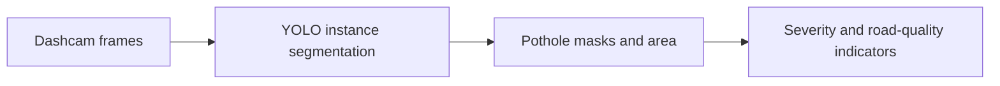

# Road Health Predictor

**Computer vision project by Debjit Roy** · Pothole instance segmentation · Dashcam analytics

Road maintenance teams need to see where a defect is and how much of the road it
occupies. This project explores a dashcam pipeline that converts pothole masks
into frame-level summaries for road inspection.

## Pipeline

| Output | Interpretation |
| --- | --- |
| Instance mask | Pixel-level outline for each detected pothole |
| Area-based severity | A heuristic score based on the detected mask area |
| Relative depth index | A proxy for comparing detections under similar capture conditions |
| Road Quality Index (RQI) | A project-specific 0–100 road-condition score |
| Damage risk and pothole density | Indicators for comparing footage and prioritizing frames for review |

Mask area changes with camera distance, angle, and resolution. The depth proxy
has no physical units. Wet patches, shadows, and damaged surfaces are useful
negative examples when evaluating false positives.

## Repository status

This public repository currently provides the project overview. Source code,
trained weights, deployment benchmarks, and a runnable demo are not published
here. The table describes the prototype design and its intended interpretation.

For another project with inspectable source code, see
[Semantic Search for NCO-2015](https://github.com/Debjit-2005-ML/semanticNCO).
